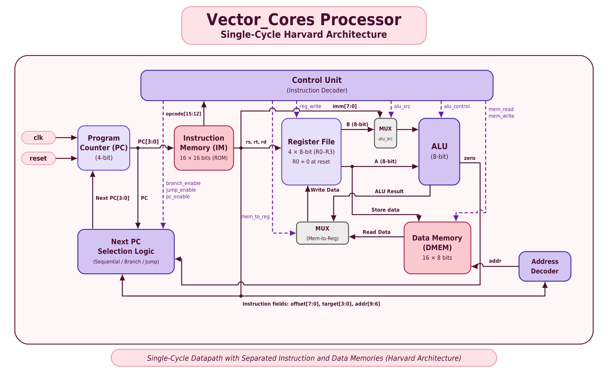

# Vector Cores

## Design and Implementation of an Instruction and Data Memory Hierarchy Using Harvard Architecture

A Verilog HDL implementation of a simplified **16-bit, single-cycle processor** based on Harvard Architecture. The processor uses separate instruction and data memories and supports arithmetic, memory-access, conditional-branch, jump, and halt instructions.

**Course:** MCA Computer Architecture  


---

## 1. Project Overview

Vector Cores is an educational processor implemented using Verilog HDL (IEEE 1364-2001). It follows Harvard Architecture, with separate instruction and data memories and independent memory paths. The processor uses a single-cycle execution model: each completed instruction executes in one clock cycle.

Project objectives:
- Design a modular processor architecture.
- Implement instruction fetching and opcode decoding.
- Perform register operations and 8-bit arithmetic.
- Support data-memory reads and writes.
- Implement conditional branches, jumps, and HALT.
- Verify behavior with Verilog testbenches.
- Analyze the synthesized logic using Yosys.

## 2. Architecture Specifications

| Component | Specification |
|---|---|
| Architecture | Harvard Architecture |
| Processor type | Single-cycle |
| Instruction width | 16 bits |
| Data width | 8 bits |
| Opcode | 4 bits (`instr[15:12]`) |
| Program Counter | 4 bits |
| Instruction Memory | 16 × 16 bits |
| Data Memory | 16 × 8 bits |
| Register File | 4 × 8-bit registers (`R0`–`R3`) |
| Clock edge | Rising edge (`posedge clk`) |
| Reset | Active-high synchronous reset |

`R0` is hardwired to zero. `R1`, `R2`, and `R3` are writable. Arithmetic results are 8 bits wide and wrap modulo 256.

## 3. System Architecture

### 3.1 Program Counter (`program_counter`)
- Maintains the current instruction address using a 4-bit register.
- Updates to the selected next address when enabled.
- Supports sequential execution, branches, and jumps.
- Holds its value when HALT disables the PC.

### 3.2 Instruction Memory (`instruction_memory`)
- Stores 16 instructions, each 16 bits wide.
- Uses combinational (asynchronous) reads.
- Initializes its contents from `program.hex` using `$readmemh`.

### 3.3 Control Unit (`control_unit`)
Decodes the 4-bit opcode and generates control signals for register writes, memory operations, ALU selection, write-back selection, branches, jumps, PC enable, and HALT.

### 3.4 Register File (`register_file`)
- Four 8-bit registers (`R0`–`R3`).
- Two combinational read ports and one synchronous write port.
- Reads from `R0` return zero; writes to `R0` are blocked.

### 3.5 Arithmetic Logic Unit (`alu`)
- Supports addition and subtraction.
- Produces an 8-bit result and a zero flag.
- Arithmetic wraps modulo 256.

### 3.6 Data Memory (`data_memory`)
- Contains 16 locations of 8 bits each.
- Supports combinational reads and synchronous writes.
- Synchronously clears all locations during reset.
- Instantiates the 4-to-16 Address Decoder internally.

### 3.7 Address Decoder (`address_decoder`)
Implements a 4-to-16 one-hot decoder. It is instantiated inside Data Memory, not as a separate top-level datapath module.

### 3.8 Next-PC Selection
The Top Module selects the next PC from:
- Sequential execution: `PC + 1`.
- Conditional branch: `PC + 1 + signed_offset`.
- Jump: absolute 4-bit target.
- HALT: hold the current PC.

The branch target is truncated to the 4-bit PC address space and therefore wraps within `0x0`–`0xF`.

### 3.9 Block Diagram



The diagram is stored at [`docs/architecture/block_diagram.png`](docs/architecture/block_diagram.png).

## 4. Supported Instruction Set

All instructions are 16 bits wide. The opcode occupies bits `[15:12]`.

| Instruction | Opcode | Operation |
|---|---:|---|
| `LOAD` | `0001` | `R[rd] = DMEM[address]` |
| `STORE` | `0010` | `DMEM[address] = R[rs]` |
| `ADD` | `0011` | `R[rd] = R[rs] + R[rt]` |
| `SUB` | `0100` | `R[rd] = R[rs] - R[rt]` |
| `ADDI` | `0101` | `R[rd] = R[rs] + immediate` |
| `BEQ` | `0110` | Branch if `R[rs] == R[rt]` |
| `JUMP` | `0111` | `PC = target` |
| `HALT` | `1111` | Disable PC updates and assert `halted` |

### 4.1 Instruction Encoding

| Instruction | Bit fields |
|---|---|
| `LOAD` | `[15:12]` opcode, `[11:10]` `rd`, `[9:6]` address, `[5:0]` zero |
| `STORE` | `[15:12]` opcode, `[11:10]` `rs`, `[9:6]` address, `[5:0]` zero |
| `ADD` / `SUB` | `[15:12]` opcode, `[11:10]` `rd`, `[9:8]` `rs`, `[7:6]` `rt`, `[5:0]` zero |
| `ADDI` | `[15:12]` opcode, `[11:10]` `rd`, `[9:8]` `rs`, `[7:0]` signed immediate |
| `BEQ` | `[15:12]` opcode, `[11:10]` `rs`, `[9:8]` `rt`, `[7:0]` signed offset |
| `JUMP` | `[15:12]` opcode, `[11:4]` zero, `[3:0]` target |
| `HALT` | `[15:12]` opcode, `[11:0]` zero |

The `BEQ` offset is signed and added to `PC + 1`; the resulting target is truncated to 4 bits. `JUMP` uses an absolute 4-bit target address.

## 5. Repository Structure

```text
Vector_Cores/
├── .gitignore
├── README.md
├── program.hex
├── instruction_memory.vcd
├── data_memory.vcd
├── processor.vcd
├── rtl/
│   ├── address_decoder.v
│   ├── alu.v
│   ├── control_unit.v
│   ├── data_memory.v
│   ├── instruction_memory.v
│   ├── program_counter.v
│   ├── register_file.v
│   └── top_module.v
├── testbench/
│   ├── alu_tb.v
│   ├── boundary_reset_tb.v
│   ├── control_flow_tb.v
│   ├── control_unit_tb.v
│   ├── data_memory_tb.v
│   ├── instruction_memory_tb.v
│   ├── processor_tb.v
│   ├── program_counter_tb.v
│   └── register_file_tb.v
├── simulation/
│   ├── logs/
│   │   ├── yosys_synthesis.log
│   │   └── yosys_synthesis_final.log
│   └── waveforms/
│       ├── boundary_reset_wave.vcd
│       ├── control_flow_wave.vcd
│       └── processor_wave.vcd
├── docs/
│   ├── architecture/
│   │   └── block_diagram.png
│   └── report/
│       └── individual_contribution_report.md
└── synthesis/
    └── results.md
```

## 6. Team Members and Individual Contributions

| Team member | Responsibilities |
|---|---|
| **Pratiti Paul** | Implemented the Program Counter and Control Unit; developed the Top Module; processor-level verification, waveform analysis, and synthesis. |
| **Anuradha Raghuwanshi** | Implemented Instruction Memory, developed its testbench, and prepared `program.hex`. |
| **Ganga** | Implemented Data Memory and the 4-to-16 Address Decoder, along with its testbench. |
| **Alisha Gupta** | Implemented the ALU and Register File and developed their respective testbenches. |

The modules were integrated collaboratively, with team members coordinating interfaces and reviewing processor behavior.

## 7. Technologies and Tools

| Tool / Technology | Purpose |
|---|---|
| Verilog HDL (IEEE 1364-2001) | Hardware description and RTL implementation |
| Icarus Verilog | Compilation and functional simulation |
| GTKWave | VCD waveform visualization |
| Yosys 0.70 | Generic synthesis and Xilinx 7-Series technology mapping |
| Git and GitHub | Version control and collaboration |

## 8. Getting Started

### 8.1 Prerequisites

Install Git, Icarus Verilog (`iverilog` and `vvp`), GTKWave (optional, for waveform viewing), and Yosys (for synthesis).

### 8.2 Clone the Repository

```bash
git clone https://github.com/Pratiti-paul/Vector_Cores.git
cd Vector_Cores
```

### 8.3 Compile and Run the Processor Integration Test

Run from the repository root because Instruction Memory loads `program.hex` using a relative path.

```bash
iverilog -s processor_tb -o proc_test \
  rtl/top_module.v rtl/program_counter.v rtl/instruction_memory.v \
  rtl/control_unit.v rtl/register_file.v rtl/alu.v \
  rtl/data_memory.v rtl/address_decoder.v \
  testbench/processor_tb.v

vvp proc_test
rm -f proc_test
```

### 8.4 Run All Nine Testbenches

This regression command runs the nine testbenches in sequence. Each subsequent test runs only if the preceding command succeeds.

```bash
iverilog -s program_counter_tb -o pc_test rtl/program_counter.v testbench/program_counter_tb.v && vvp pc_test && rm -f pc_test && \
iverilog -s control_unit_tb -o control_test rtl/control_unit.v testbench/control_unit_tb.v && vvp control_test && rm -f control_test && \
iverilog -s instruction_memory_tb -o imem_test rtl/instruction_memory.v testbench/instruction_memory_tb.v && vvp imem_test && rm -f imem_test && \
iverilog -s data_memory_tb -o dmem_test rtl/address_decoder.v rtl/data_memory.v testbench/data_memory_tb.v && vvp dmem_test && rm -f dmem_test && \
iverilog -s alu_tb -o alu_test rtl/alu.v testbench/alu_tb.v && vvp alu_test && rm -f alu_test && \
iverilog -s register_file_tb -o rf_test rtl/register_file.v testbench/register_file_tb.v && vvp rf_test && rm -f rf_test && \
iverilog -s processor_tb -o proc_test rtl/*.v testbench/processor_tb.v && vvp proc_test && rm -f proc_test && \
iverilog -s control_flow_tb -o cf_test rtl/*.v testbench/control_flow_tb.v && vvp cf_test && rm -f cf_test && \
iverilog -s boundary_reset_tb -o br_test rtl/*.v testbench/boundary_reset_tb.v && vvp br_test && rm -f br_test
```

### 8.5 Individual Testbench Commands

| Testbench | Compile command | Run command |
|---|---|---|
| Program Counter | `iverilog -s program_counter_tb -o pc_test rtl/program_counter.v testbench/program_counter_tb.v` | `vvp pc_test` |
| Control Unit | `iverilog -s control_unit_tb -o control_test rtl/control_unit.v testbench/control_unit_tb.v` | `vvp control_test` |
| Instruction Memory | `iverilog -s instruction_memory_tb -o imem_test rtl/instruction_memory.v testbench/instruction_memory_tb.v` | `vvp imem_test` |
| Data Memory | `iverilog -s data_memory_tb -o dmem_test rtl/address_decoder.v rtl/data_memory.v testbench/data_memory_tb.v` | `vvp dmem_test` |
| ALU | `iverilog -s alu_tb -o alu_test rtl/alu.v testbench/alu_tb.v` | `vvp alu_test` |
| Register File | `iverilog -s register_file_tb -o rf_test rtl/register_file.v testbench/register_file_tb.v` | `vvp rf_test` |
| Processor | `iverilog -s processor_tb -o proc_test rtl/*.v testbench/processor_tb.v` | `vvp proc_test` |
| Control Flow | `iverilog -s control_flow_tb -o cf_test rtl/*.v testbench/control_flow_tb.v` | `vvp cf_test` |
| Boundary and Reset | `iverilog -s boundary_reset_tb -o br_test rtl/*.v testbench/boundary_reset_tb.v` | `vvp br_test` |

## 9. Verification and Testing

Nine dedicated testbenches were used.

| Testbench | Checks passed | Failed |
|---|---:|---:|
| Program Counter | 5 | 0 |
| Control Unit | 8 | 0 |
| Instruction Memory | 43 | 0 |
| Data Memory | 38 | 0 |
| ALU | 7 | 0 |
| Register File | 6 | 0 |
| Processor Integration | 7 | 0 |
| Control Flow | 13 | 0 |
| Boundary and Reset | 15 | 0 |
| **Total** | **142** | **0** |

### 9.1 Verification Coverage

Testing covers:
- Individual module functionality.
- Instruction fetching and decoding.
- Arithmetic operations.
- Register-file read and write behavior.
- Data-memory reads and writes.
- Branch taken and not-taken conditions.
- Forward and backward branch offsets.
- Jump execution.
- HALT behavior and PC freeze.
- Negative branch offsets and PC wraparound.
- Reset behavior across processor components.

### 9.2 Processor-Level Test Program

The program in `program.hex` performs the following operations:

| Address | Hex | Assembly | Result |
|---:|---:|---|---|
| `0x0` | `5405` | `ADDI R1, R0, 5` | `R1 = 5` |
| `0x1` | `5803` | `ADDI R2, R0, 3` | `R2 = 3` |
| `0x2` | `3580` | `ADD R1, R1, R2` | `R1 = 8` |
| `0x3` | `2480` | `STORE R1, [2]` | `DMEM[2] = 8` |
| `0x4` | `4580` | `SUB R1, R1, R2` | `R1 = 5` |
| `0x5` | `1C80` | `LOAD R3, [2]` | `R3 = 8` |
| `0x6` | `5F01` | `ADDI R3, R3, 1` | `R3 = 9` |
| `0x7` | `F000` | `HALT` | `PC = 7`, `halted = 1` |

Locations `0x8`–`0xF` contain `F000` (HALT).

**Expected final architectural state:**

| Component | Expected value |
|---|---:|
| `R0` | 0 |
| `R1` | 5 |
| `R2` | 3 |
| `R3` | 9 |
| `DMEM[2]` | 8 |
| Program Counter | 7 |
| `halted` | 1 |

The processor-level test verifies these values and confirms that the PC remains at 7 after HALT.

## 10. Synthesis and Resource Analysis

The complete processor hierarchy was synthesized using **Yosys 0.70**, with `top_module` as the top-level module.

### 10.1 Generic Synthesis Command

Run from the repository root:

```bash
yosys -p "
read_verilog rtl/program_counter.v rtl/instruction_memory.v rtl/control_unit.v rtl/register_file.v rtl/alu.v rtl/address_decoder.v rtl/data_memory.v rtl/top_module.v
hierarchy -check -top top_module
proc
opt
memory
opt
check
stat
" | tee simulation/logs/yosys_synthesis_final.log
```

The recorded structural check reported:

```text
Found and reported 0 problems.
```

### 10.2 Generic Cell Statistics

| Cell type | Count |
|---|---:|
| `$mux` | 47 |
| `$eq` | 18 |
| `$sdffe` | 17 |
| `$and` | 9 |
| `$logic_not` | 5 |
| `$reduce_bool` | 5 |
| `$dffe` | 4 |
| `$add` | 3 |
| `$not` | 2 |
| `$pmux` | 2 |
| `$shl` | 1 |
| `$sub` | 1 |
| `$logic_and` | 1 |
| `$logic_or` | 1 |
| **Total generic cells** | **116** |

The report also recorded 186 wires (939 wire bits), 107 public wires (540 public wire bits), and 50 ports (191 port bits).

### 10.3 Xilinx 7-Series Technology Mapping

The technical audit recorded the following technology-mapping results for the AMD Xilinx 7-Series family (`xc7`):

| Resource | Count |
|---|---:|
| Slice registers (`FDRE`) | 156 |
| Slice LUTs | 184 |
| Carry chains (`CARRY4`) | 6 |
| Clock buffers (`BUFG`) | 1 |
| Input buffers (`IBUF`) | 2 |
| Output buffers (`OBUF`) | 38 |
| Estimated logic cells | 170 |

The reported register breakdown is 128 Data Memory bits, 24 writable Register File bits (`R1`–`R3`), and 4 Program Counter bits. The LUT breakdown is LUT2: 14, LUT3: 28, LUT4: 32, LUT5: 85, and LUT6: 25.

**Reproducibility note:** These are technology-mapping results recorded by the project audit, not measured board utilization or timing results. The audit did not provide the exact `synth_xilinx` command or a separate target-mapping log path, so those details are not specified here.

### 10.4 Memory Mapping Observation

Yosys reported that the Data Memory array was replaced with a list of registers. The implementation synchronously clears all 16 memory locations during reset, so the reported generic synthesis flow maps the storage to registers rather than conventional block RAM.

## 11. Waveform Archives

| Waveform | Location | Generating testbench |
|---|---|---|
| Instruction Memory | `instruction_memory.vcd` | `instruction_memory_tb.v` |
| Data Memory | `data_memory.vcd` | `data_memory_tb.v` |
| Processor (root output) | `processor.vcd` | `processor_tb.v` |
| Processor (archived) | `simulation/waveforms/processor_wave.vcd` | `processor_tb.v` |
| Control Flow | `simulation/waveforms/control_flow_wave.vcd` | `control_flow_tb.v` |
| Boundary and Reset | `simulation/waveforms/boundary_reset_wave.vcd` | `boundary_reset_tb.v` |

Open the archived system-level waveforms using GTKWave:

```bash
gtkwave simulation/waveforms/processor_wave.vcd
gtkwave simulation/waveforms/control_flow_wave.vcd
gtkwave simulation/waveforms/boundary_reset_wave.vcd
```

## 12. Limitations and Future Improvements

1. **Data Memory mapping:** Synchronous reset clears all memory locations in one clock cycle. The reported synthesis flow therefore maps the memory to registers instead of conventional block RAM.
2. **Asynchronous Instruction Memory:** Instruction Memory uses combinational reads. A different implementation may be needed for FPGA block RAM configurations.
3. **Relative program-file path:** Instruction Memory loads `program.hex` using a relative path. Run simulations from the repository root.
4. **Small address space:** The 4-bit address buses limit instruction and data memories to 16 locations each.
5. **Instruction set:** The processor currently supports eight instructions. Additional arithmetic, logical, and control-flow instructions could be added.
6. **Datapath capacity:** Future versions could increase data width, register count, and memory capacity.
7. **Further hardware characterization:** Board-level testing, maximum-frequency measurement, critical-path timing analysis, and power measurement remain future work.

## 13. Performance Metrics

The processor uses a single-cycle execution model:

- **Cycles per instruction (CPI):** 1 for each completed instruction.
- **Ideal throughput:** 1 instruction per clock cycle.
- **Instruction width:** 16 bits.
- **Data width:** 8 bits.

The throughput is an architectural ideal. Actual operating frequency and instructions per second have not been measured.

## 14. Conclusion

Vector Cores demonstrates the design and implementation of a simplified single-cycle processor using Harvard Architecture and Verilog HDL. The implementation integrates instruction fetching, decoding, register operations, arithmetic processing, data-memory access, and control-flow management.

Nine dedicated testbenches completed **142 checks with zero failures**. Generic synthesis using Yosys reported **116 cells** and zero structural problems. The project also records Xilinx 7-Series technology-mapping results.

## 15. Individual Contributions Report

The detailed contribution report is available at [`docs/report/individual_contribution_report.md`](docs/report/individual_contribution_report.md).


