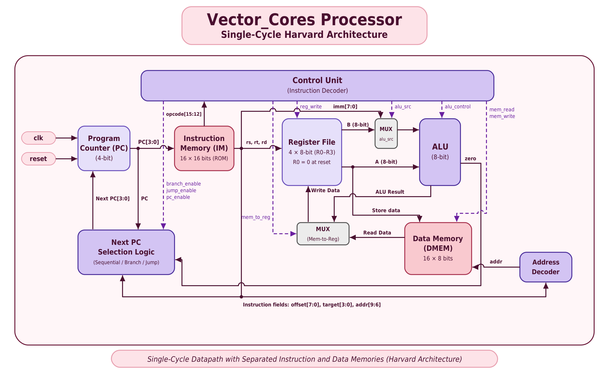

# Vector Cores

## Design and Implementation of an Instruction and Data Memory Hierarchy Using Harvard Architecture

A Verilog HDL implementation of a simplified **16-bit, single-cycle processor** based on Harvard Architecture. The processor uses separate instruction and data memories and supports arithmetic, logical, memory-access, conditional-branch, jump, and halt instructions.

**Course:** MCA Computer Architecture

---

## 1. Project Overview

Vector Cores is an educational processor implemented using Verilog HDL (IEEE 1364-2001). It follows Harvard Architecture, with separate instruction and data memories and independent memory paths. The processor uses a single-cycle execution model: each completed instruction executes in one clock cycle.

### Project objectives

- Design a modular processor architecture.
- Implement instruction fetching and opcode decoding.
- Perform register operations and 8-bit arithmetic and logical operations.
- Support data-memory reads and writes.
- Implement conditional branches, jumps, and HALT.
- Extend the instruction set with AND, OR, and XOR operations.
- Assemble symbolic assembly programs into machine-code instructions.
- Verify module-level and processor-level behavior with Verilog testbenches.
- Analyze the synthesized logic using Yosys.
- Compare the Harvard design against a Von Neumann (shared-memory) baseline.

## 2. Architecture Specifications

| Component | Specification |
|---|---|
| Architecture | Harvard Architecture |
| Processor type | Single-cycle |
| Instruction width | 16 bits |
| Data width | 8 bits |
| Opcode | 4 bits (`instr[15:12]`) |
| Program Counter | 4 bits |
| Instruction Memory | 16 × 16 bits |
| Data Memory | 16 × 8 bits |
| Register File | 4 × 8-bit registers (`R0`–`R3`) |
| ALU control | 3 bits |
| Clock edge | Rising edge (`posedge clk`) |
| Reset | Active-high synchronous reset |

`R0` is hardwired to zero. `R1`, `R2`, and `R3` are writable. Arithmetic results are 8 bits wide and wrap modulo 256.

## 3. System Architecture

### 3.1 Program Counter (`program_counter`)

- Maintains the current instruction address using a 4-bit register.
- Updates to the selected next address when enabled.
- Supports sequential execution, branches, and jumps.
- Holds its value when HALT disables the PC.

### 3.2 Instruction Memory (`instruction_memory`)

- Stores 16 instructions, each 16 bits wide.
- Uses combinational (asynchronous) reads.
- Initializes its contents from `program.hex` using `$readmemh`.

### 3.3 Control Unit (`control_unit`)

Decodes the 4-bit opcode and generates control signals for register writes, memory operations, ALU selection, write-back selection, branches, jumps, PC enable, and HALT. The Phase II Control Unit supports all 11 instructions listed in Section 4 and uses a 3-bit ALU control signal.

### 3.4 Register File (`register_file`)

- Four 8-bit registers (`R0`–`R3`).
- Two combinational read ports and one synchronous write port.
- Reads from `R0` return zero; writes to `R0` are blocked.

### 3.5 Arithmetic Logic Unit (`alu`)

- Supports addition and subtraction.
- Supports bitwise AND, OR, and XOR.
- Produces an 8-bit result and a zero flag.
- Arithmetic results wrap modulo 256.

The 3-bit ALU control mapping is:

| ALU control | Operation |
|---|---|
| `000` | ADD |
| `001` | SUB |
| `010` | AND |
| `011` | OR |
| `100` | XOR |
| `101`–`111` | Reserved (default result: `8'h00`) |

### 3.6 Data Memory (`data_memory`)

- Contains 16 locations of 8 bits each.
- Supports combinational reads and synchronous writes.
- Synchronously clears all locations during reset.
- Instantiates the 4-to-16 Address Decoder internally.

### 3.7 Address Decoder (`address_decoder`)

Implements a 4-to-16 one-hot decoder. It is instantiated inside Data Memory, not as a separate top-level datapath module.

### 3.8 Next-PC Selection

The Top Module selects the next PC from:

- Sequential execution: `PC + 1`.
- Conditional branch: `PC + 1 + signed_offset`.
- Jump: absolute 4-bit target.
- HALT: hold the current PC.

The branch target is truncated to the 4-bit PC address space and therefore wraps within `0x0`–`0xF`.

### 3.9 Block Diagram



The diagram is stored at [`docs/architecture/block_diagram.png`](docs/architecture/block_diagram.png).

## 4. Supported Instruction Set

All instructions are 16 bits wide. The opcode occupies bits `[15:12]`. The processor supports 11 instructions:

| Instruction | Opcode | Operation |
|---|---:|---|
| `LOAD` | `0001` | `R[rd] = DMEM[address]` |
| `STORE` | `0010` | `DMEM[address] = R[rs]` |
| `ADD` | `0011` | `R[rd] = R[rs] + R[rt]` |
| `SUB` | `0100` | `R[rd] = R[rs] - R[rt]` |
| `ADDI` | `0101` | `R[rd] = R[rs] + signed_immediate` |
| `BEQ` | `0110` | Branch if `R[rs] == R[rt]` |
| `JUMP` | `0111` | `PC = target` |
| `AND` | `1000` | `R[rd] = R[rs] & R[rt]` (Bitwise AND) |
| `OR` | `1001` | `R[rd] = R[rs] \| R[rt]` (Bitwise OR) |
| `XOR` | `1010` | `R[rd] = R[rs] ^ R[rt]` (Bitwise XOR) |
| `HALT` | `1111` | Disable PC updates and assert `halted` |

### 4.1 Instruction Encoding

| Instruction | Bit fields |
|---|---|
| `LOAD` | `[15:12]` opcode, `[11:10]` `rd`, `[9:6]` address, `[5:0]` zero |
| `STORE` | `[15:12]` opcode, `[11:10]` `rs`, `[9:6]` address, `[5:0]` zero |
| `ADD` / `SUB` | `[15:12]` opcode, `[11:10]` `rd`, `[9:8]` `rs`, `[7:6]` `rt`, `[5:0]` zero |
| `AND` / `OR` / `XOR` | `[15:12]` opcode, `[11:10]` `rd`, `[9:8]` `rs`, `[7:6]` `rt`, `[5:0]` zero |
| `ADDI` | `[15:12]` opcode, `[11:10]` `rd`, `[9:8]` `rs`, `[7:0]` signed immediate |
| `BEQ` | `[15:12]` opcode, `[11:10]` `rs`, `[9:8]` `rt`, `[7:0]` signed offset |
| `JUMP` | `[15:12]` opcode, `[11:4]` zero, `[3:0]` target |
| `HALT` | `[15:12]` opcode, `[11:0]` zero |

The `BEQ` offset is signed and added to `PC + 1`; the resulting target is truncated to 4 bits. `JUMP` uses an absolute 4-bit target address. The three logical instructions use the same R-type field layout as `ADD` and `SUB`.

### 4.2 ALU Control Encoding (3-Bit)

The ALU and Control Unit communicate using a dedicated 3-bit control bus (`alu_control[2:0]`):

| `alu_control` | Operation | Associated Instructions |
|:---:|---|---|
| `3'b000` | Addition (`alu_in1 + alu_in2`) | `ADD`, `ADDI` |
| `3'b001` | Subtraction (`alu_in1 - alu_in2`) | `SUB`, `BEQ` |
| `3'b010` | Bitwise AND (`alu_in1 & alu_in2`) | `AND` |
| `3'b011` | Bitwise OR (`alu_in1 \| alu_in2`) | `OR` |
| `3'b100` | Bitwise XOR (`alu_in1 ^ alu_in2`) | `XOR` |
| Other | Default zero (`8'h00`) | Invalid opcodes / Safe default |

## 5. Repository Structure

```text
Vector_Cores/
├── README.md
├── program.hex
├── assembler/
│   ├── __init__.py
│   ├── __main__.py
│   ├── assembler.py
│   ├── encoder.py
│   ├── instructions.py
│   ├── parser.py
│   ├── validator.py
│   └── samples/
│       ├── basic_alu.asm
│       ├── branch_jump.asm
│       └── logical_ops.asm
├── tests/
│   ├── __init__.py
│   ├── test_assembler.py
│   ├── test_encoder.py
│   ├── test_parser.py
│   └── test_validation.py
├── rtl/
│   ├── address_decoder.v
│   ├── alu.v
│   ├── control_unit.v
│   ├── data_memory.v
│   ├── instruction_memory.v
│   ├── program_counter.v
│   ├── register_file.v
│   ├── top_module.v
│   └── baseline/                    # Von Neumann comparison baseline
│       ├── unified_memory.v
│       └── vn_top_module.v
├── testbench/
│   ├── address_decoder_tb.v
│   ├── alu_tb.v
│   ├── address_decoder_tb.v
│   ├── boundary_reset_tb.v
│   ├── control_flow_tb.v
│   ├── control_unit_tb.v
│   ├── data_memory_tb.v
│   ├── harvard_vs_vn_tb.v
│   ├── instruction_memory_tb.v
│   ├── logical_ops_tb.v
│   ├── processor_tb.v
│   ├── program_counter_tb.v
│   └── register_file_tb.v
├── assembler/
│   ├── assembler.py
│   └── samples/
├── tests/
├── simulation/
│   ├── logical_ops_assembled.hex
│   ├── logs/
│   │   ├── yosys_synthesis.log
│   │   ├── yosys_synthesis_final.log
│   │   └── yosys_synthesis_phase2.log
│   └── waveforms/
│       ├── boundary_reset_wave.vcd
│       ├── control_flow_wave.vcd
│       ├── harvard_vs_vn_wave.vcd
│       ├── logical_ops_wave.vcd
│       └── processor_wave.vcd
├── docs/
│   ├── architecture_comparison.md
│   ├── assembler_design.md
│   ├── data_memory_verification.md
│   ├── architecture/
│   │   └── block_diagram.png
│   ├── report/
│   │   ├── Final Report.pdf
│   │   └── individual_contribution_report.md
│   └── Video/
│       └── video.md
└── synthesis/
    └── results.md
```

This is a high-level guide to the repository. Some generated logs, waveforms, and supporting files may be present in addition to the paths shown above.

## 6. Team Members and Individual Contributions

| Team member | Responsibilities |
|---|---|
| **Pratiti Paul** | Implemented the Program Counter and Control Unit; developed the Top Module; handled processor integration, processor-level verification, waveform analysis, and synthesis. |
| **Anuradha Raghuwanshi** | Implemented Instruction Memory and its testbench; prepared the Phase I program image; developed the Phase II Python two-pass assembler, assembler tests, and sample assembly programs. |
| **Ganga Raghuwanshi** | Implemented Data Memory and the 4-to-16 Address Decoder; developed expanded memory and decoder verification. |
| **Alisha Gupta** | Implemented the ALU and Register File; extended the ALU with AND, OR, and XOR operations and developed the related testbenches. |

The modules were integrated collaboratively, with team members coordinating interfaces and reviewing processor behavior.

## 7. Technologies and Tools

| Tool / Technology | Purpose |
|---|---|
| Verilog HDL (IEEE 1364-2001) | Hardware description and RTL implementation |
| Icarus Verilog (`iverilog`, `vvp`) | Compilation and functional simulation |
| Python 3 & pytest | 2-pass Python Assembler implementation and test suite |
| GTKWave | VCD waveform visualization |
| Yosys 0.70 | Generic logic synthesis and structural verification |
| Git and GitHub | Version control and team branch management |

## 8. Getting Started

### 8.1 Prerequisites

Install Git, Icarus Verilog (`iverilog` and `vvp`), Python 3 and pytest, GTKWave (optional, for waveform viewing), and Yosys (for synthesis).

### 8.2 Clone the Repository

```bash
git clone https://github.com/Pratiti-paul/Vector_Cores.git
cd Vector_Cores
```

### 8.3 Python Assembler Workflow

The repository includes a standalone two-pass Python assembler in `assembler/`:

```bash
# Assemble an assembly source file into a 16-line hex file for instruction memory:
python3 -m assembler.assembler assembler/samples/logical_ops.asm -o simulation/logical_ops_assembled.hex

# Run the full assembler test suite (203 tests):
pytest tests/
```

### 8.4 Compile and Run the Processor Integration Test

Run from the repository root because Instruction Memory loads `program.hex` using a relative path.

```bash
iverilog -g2012 -s processor_tb -o proc_test rtl/*.v testbench/processor_tb.v
vvp proc_test
rm -f proc_test
```

### 8.5 Run All Twelve Verilog Testbenches (Full Regression)

This regression command runs all twelve testbenches sequentially:

```bash
iverilog -g2012 -s program_counter_tb -o pc_test rtl/program_counter.v testbench/program_counter_tb.v && vvp pc_test && rm -f pc_test && \
iverilog -g2012 -s control_unit_tb -o control_test rtl/control_unit.v testbench/control_unit_tb.v && vvp control_test && rm -f control_test && \
iverilog -g2012 -s instruction_memory_tb -o imem_test rtl/instruction_memory.v testbench/instruction_memory_tb.v && vvp imem_test && rm -f imem_test && \
iverilog -g2012 -s address_decoder_tb -o dec_test rtl/address_decoder.v testbench/address_decoder_tb.v && vvp dec_test && rm -f dec_test && \
iverilog -g2012 -s data_memory_tb -o dmem_test rtl/address_decoder.v rtl/data_memory.v testbench/data_memory_tb.v && vvp dmem_test && rm -f dmem_test && \
iverilog -g2012 -s alu_tb -o alu_test rtl/alu.v testbench/alu_tb.v && vvp alu_test && rm -f alu_test && \
iverilog -g2012 -s register_file_tb -o rf_test rtl/register_file.v testbench/register_file_tb.v && vvp rf_test && rm -f rf_test && \
iverilog -g2012 -s processor_tb -o proc_test rtl/*.v testbench/processor_tb.v && vvp proc_test && rm -f proc_test && \
iverilog -g2012 -s control_flow_tb -o cf_test rtl/*.v testbench/control_flow_tb.v && vvp cf_test && rm -f cf_test && \
iverilog -g2012 -s boundary_reset_tb -o br_test rtl/*.v testbench/boundary_reset_tb.v && vvp br_test && rm -f br_test && \
iverilog -g2012 -s logical_ops_tb -o log_test rtl/*.v testbench/logical_ops_tb.v && vvp log_test && rm -f log_test && \
iverilog -g2012 -s harvard_vs_vn_tb -o cmp_test rtl/*.v rtl/baseline/*.v testbench/harvard_vs_vn_tb.v && vvp cmp_test && rm -f cmp_test
```

### 8.6 Individual Testbench Commands

| Testbench | Compile command | Run command |
|---|---|---|
| Program Counter | `iverilog -g2012 -s program_counter_tb -o pc_test rtl/program_counter.v testbench/program_counter_tb.v` | `vvp pc_test` |
| Control Unit | `iverilog -g2012 -s control_unit_tb -o control_test rtl/control_unit.v testbench/control_unit_tb.v` | `vvp control_test` |
| Instruction Memory | `iverilog -g2012 -s instruction_memory_tb -o imem_test rtl/instruction_memory.v testbench/instruction_memory_tb.v` | `vvp imem_test` |
| Address Decoder | `iverilog -g2012 -s address_decoder_tb -o dec_test rtl/address_decoder.v testbench/address_decoder_tb.v` | `vvp dec_test` |
| Data Memory | `iverilog -g2012 -s data_memory_tb -o dmem_test rtl/address_decoder.v rtl/data_memory.v testbench/data_memory_tb.v` | `vvp dmem_test` |
| ALU | `iverilog -g2012 -s alu_tb -o alu_test rtl/alu.v testbench/alu_tb.v` | `vvp alu_test` |
| Register File | `iverilog -g2012 -s register_file_tb -o rf_test rtl/register_file.v testbench/register_file_tb.v` | `vvp rf_test` |
| Processor Integration | `iverilog -g2012 -s processor_tb -o proc_test rtl/*.v testbench/processor_tb.v` | `vvp proc_test` |
| Control Flow | `iverilog -g2012 -s control_flow_tb -o cf_test rtl/*.v testbench/control_flow_tb.v` | `vvp cf_test` |
| Boundary and Reset | `iverilog -g2012 -s boundary_reset_tb -o br_test rtl/*.v testbench/boundary_reset_tb.v` | `vvp br_test` |
| Logical Operations | `iverilog -g2012 -s logical_ops_tb -o log_test rtl/*.v testbench/logical_ops_tb.v` | `vvp log_test` |
| Harvard vs Von Neumann | `iverilog -g2012 -s harvard_vs_vn_tb -o cmp_test rtl/*.v rtl/baseline/*.v testbench/harvard_vs_vn_tb.v` | `vvp cmp_test` |

## 9. Verification and Testing

Twelve dedicated Verilog testbenches plus an automated Python pytest suite provide comprehensive coverage.

| Testbench | Level | Checks passed | Failed | Status |
|---|---|---:|---:|:---:|
| `program_counter_tb.v` | Unit | 35 | 0 | **PASS** |
| `instruction_memory_tb.v` | Unit | 16 | 0 | **PASS** |
| `register_file_tb.v` | Unit | 6 | 0 | **PASS** |
| `alu_tb.v` | Unit | 13 | 0 | **PASS** |
| `address_decoder_tb.v` | Unit | 40 | 0 | **PASS** |
| `data_memory_tb.v` | Unit | 79 | 0 | **PASS** |
| `control_unit_tb.v` | Unit | 130 | 0 | **PASS** |
| `processor_tb.v` | System | 7 | 0 | **PASS** |
| `control_flow_tb.v` | System | 13 | 0 | **PASS** |
| `boundary_reset_tb.v` | System | 15 | 0 | **PASS** |
| `logical_ops_tb.v` | System | 56 | 0 | **PASS** |
| `harvard_vs_vn_tb.v` | Comparison | 151 | 0 | **PASS** |
| **Total Verilog Checks** | — | **561** | **0** | **100% PASS** |
| **Python Assembler (`pytest`)** | Tool | **203** | **0** | **100% PASS** |

### 9.2 Python Assembler Tests

The recorded Python assembler test suite completed **203 tests with 0 failures** using pytest.

### 9.3 Verification Coverage

Testing covers:

- Individual module functionality.
- Instruction fetching and decoding.
- Addition, subtraction, and immediate arithmetic.
- Bitwise AND, OR, and XOR operations.
- Register-file read and write behavior, including hardwired `R0`.
- Data-memory reads, writes, and address decoding.
- Branch taken and not-taken conditions.
- Forward and backward branch offsets.
- Jump execution.
- HALT behavior and PC freeze.
- Negative branch offsets and PC wraparound.
- Reset behavior across processor components.
- Assembler parsing, label resolution, instruction encoding, and sample programs.
- Execution of assembler-generated logical-operation machine code on the processor.
- Equivalence of the Harvard processor and the Von Neumann baseline, with measured cycle counts.

### 9.4 Logical-Operations Integration Example

The Phase II logical-operations system test exercises AND, OR, and XOR through the integrated processor. The recorded example initializes `R1 = 12` and `R2 = 10`, then checks:

| Operation | Expected result |
|---|---:|
| `12 AND 10` | 8 |
| `12 OR 10` | 14 |
| `12 XOR 10` | 6 |

The system test also checks register write-back, zero-result behavior, the hardwired-zero register, and HALT/PC-freeze behavior. The recorded logical-operations testbench reported 56 checks passed and 0 failures.

## 10. Synthesis and Resource Analysis

The complete processor hierarchy was synthesized using Yosys with `top_module` as the top-level module.

### 10.1 Generic Synthesis Flow

Run from the repository root:

```bash
yosys -p "
read_verilog rtl/program_counter.v rtl/instruction_memory.v rtl/control_unit.v rtl/register_file.v rtl/alu.v rtl/address_decoder.v rtl/data_memory.v rtl/top_module.v
hierarchy -check -top top_module
proc
opt
memory
opt
check
stat
" | tee simulation/logs/yosys_synthesis_phase2.log
```

The recorded Phase II generic synthesis report states:

```text
Checking module top_module...
Checking module data_memory...
Checking module address_decoder...
Checking module alu...
Checking module register_file...
Checking module control_unit...
Checking module instruction_memory...
Checking module program_counter...
Found and reported 0 problems.
```

### 10.2 Generic Cell Statistics (Phase II vs Phase I)

| Cell type | Phase I Count | Phase II Count | Description |
|---|---:|---:|---|
| `$mux` | 47 | 50 | Multiplexers (datapath steering & control) |
| `$eq` | 18 | 21 | Equality comparators (branch evaluation, decoding) |
| `$sdffe` | 17 | 17 | Synchronous D-FF with reset & enable (16 DMEM + 1 PC) |
| `$and` | 9 | 10 | Bitwise AND gates |
| `$logic_not` | 5 | 5 | Logical inverters |
| `$reduce_bool` | 5 | 5 | Reduction boolean gates |
| `$dffe` | 4 | 4 | Register file D-flip-flops |
| `$add` | 3 | 3 | 8-bit / 4-bit adders |
| `$not` | 2 | 2 | Bitwise NOT gates |
| `$pmux` | 2 | 2 | Parallel multiplexers |
| `$sub` | 1 | 1 | 8-bit subtractor |
| `$xor` | 0 | 1 | Bitwise XOR logic gate (ALU) |
| `$or` | 0 | 1 | Bitwise OR logic gate (ALU) |
| `$shl` | 1 | 1 | Shift-left decoder logic |
| `$logic_and` | 1 | 1 | Logical AND |
| `$logic_or` | 1 | 1 | Logical OR |
| **Total generic cells** | **116** | **125** | Complete generic synthesized cell count |

The Phase II netlist contains 195 wires (1,025 wire bits), 107 public wires (543 public wire bits), and 50 ports (193 port bits).

### 10.3 Xilinx 7-Series Technology Mapping (Baseline Estimate)

The baseline technical audit recorded the following technology-mapping results for the AMD Xilinx 7-Series family (`xc7`):

| Resource | Count |
|---|---:|
| Slice registers (`FDRE`) | 156 |
| Slice LUTs | 184 |
| Carry chains (`CARRY4`) | 6 |
| Clock buffers (`BUFG`) | 1 |
| Input buffers (`IBUF`) | 2 |
| Output buffers (`OBUF`) | 38 |
| Estimated logic cells | 170 |

The reported register breakdown is 128 Data Memory bits, 24 writable Register File bits (`R1`–`R3`), and 4 Program Counter bits.

**Reproducibility note:** These are technology-mapping results recorded by the project audit, not measured board utilization or timing results.

### 10.4 Memory Mapping Observation

Yosys reported:
`Warning: Replacing memory \mem with list of registers. See rtl/data_memory.v:45`
The implementation synchronously clears all 16 memory locations during reset, so generic synthesis maps the storage to registers rather than conventional block RAM.

## 11. Waveform Archives

| Waveform | Location | Generating testbench |
|---|---|---|
| Instruction Memory | `instruction_memory.vcd` | `instruction_memory_tb.v` |
| Data Memory | `data_memory.vcd` | `data_memory_tb.v` |
| Processor (root output) | `processor.vcd` | `processor_tb.v` |
| Processor (archived) | `simulation/waveforms/processor_wave.vcd` | `processor_tb.v` |
| Control Flow | `simulation/waveforms/control_flow_wave.vcd` | `control_flow_tb.v` |
| Boundary and Reset | `simulation/waveforms/boundary_reset_wave.vcd` | `boundary_reset_tb.v` |
| Logical Operations | `simulation/waveforms/logical_ops_wave.vcd` | `logical_ops_tb.v` |
| Harvard vs Von Neumann | `simulation/waveforms/harvard_vs_vn_wave.vcd` | `harvard_vs_vn_tb.v` |

Open the archived system-level waveforms using GTKWave:

```bash
gtkwave simulation/waveforms/logical_ops_wave.vcd
gtkwave simulation/waveforms/control_flow_wave.vcd
gtkwave simulation/waveforms/boundary_reset_wave.vcd
gtkwave simulation/waveforms/logical_ops_wave.vcd
gtkwave simulation/waveforms/harvard_vs_vn_wave.vcd
```

Waveform files are generated simulation artifacts. Their availability depends on which simulations have been run and which artifacts are included in the repository.

## 12. Limitations and Future Improvements

1. **Data Memory mapping:** Synchronous reset clears all memory locations. The reported synthesis flow therefore maps the memory to registers instead of conventional block RAM.
2. **Asynchronous Instruction Memory:** Instruction Memory uses combinational reads. A different implementation may be needed for FPGA block RAM configurations.
3. **Relative program-file path:** Instruction Memory loads `program.hex` using a relative path. Run simulations from the repository root.
4. **Small address space:** The 4-bit address buses limit instruction and data memories to 16 locations each.
5. **Datapath capacity:** Future versions could increase data width, register count, and memory capacity.
6. **Further hardware characterization:** Board-level testing, maximum-frequency measurement, critical-path timing analysis, and power measurement remain future work.

## 13. Performance Metrics

The processor uses a single-cycle execution model:

- **Cycles per instruction (CPI):** 1 for each completed instruction.
- **Ideal throughput:** 1 instruction per clock cycle.
- **Instruction width:** 16 bits.
- **Data width:** 8 bits.

The throughput is an architectural ideal. Actual operating frequency and instructions per second have not been measured.

### 13.1 Harvard vs Von Neumann (Shared-Memory) Comparison

A Von Neumann baseline (`rtl/baseline/vn_top_module.v`) runs the same ISA. It reuses the same Program Counter, Control Unit, Register File, ALU, and Address Decoder, so memory organization is the only difference between the two designs:

- Instructions and data share one 32 × 16-bit `unified_memory` with a **single port**. Words `0x00`–`0x0F` hold instructions (write-protected) and `0x10`–`0x1F` hold data.
- A LOAD or STORE needs the port twice: once to fetch and once to access data. It therefore takes **2 cycles** (fetch, then data access) and stalls the PC. All other instructions still take 1 cycle.
- The Harvard design fetches and accesses data **in the same cycle**, so every instruction takes 1 cycle.

For N executed instructions, M of which are LOAD/STORE: Harvard takes **N** cycles, Von Neumann takes **N + M** cycles, and the Harvard speed-up is **1 + M/N**.

| Program | N | M | Harvard cycles | VN cycles | Harvard CPI | VN CPI | Harvard speed-up |
|---|---:|---:|---:|---:|---:|---:|---:|
| P1 `program.hex` (mixed) | 7 | 2 | 7 | 9 | 1.000 | 1.286 | **1.286×** |
| P2 memory-heavy | 10 | 7 | 10 | 17 | 1.000 | 1.700 | **1.700×** |
| P3 compute-only loop | 16 | 0 | 16 | 16 | 1.000 | 1.000 | **1.000×** |

Both processors reached identical, expected final register, data-memory, and PC states in all three programs (151 checks, 0 failures). The speed-ups are cycle-count ratios; wall-clock speed-up also depends on each design's post-synthesis Fmax, which has not been measured.

The full comparison, including the memory map, FSM diagram, analysis, and waveform signals to inspect, is in [`docs/architecture_comparison.md`](docs/architecture_comparison.md).

## 14. Conclusion

Vector Cores demonstrates the design and implementation of a modular single-cycle processor using Harvard Architecture and Verilog HDL. The implementation integrates instruction fetching, decoding, register operations, arithmetic and bitwise logical processing, data-memory access, and control-flow management. It also includes a Python two-pass assembler for translating assembly programs into machine code.

Twelve dedicated testbenches completed **561 checks with zero failures**, accompanied by a 2-pass Python assembler verified across **203 automated pytest tests**. A Von Neumann shared-memory baseline shows the Harvard design is **1.29×** faster on the main program and **1.70×** faster on a memory-heavy program, measured in clock cycles. Generic synthesis using Yosys 0.70 reported **125 cells** and zero structural problems. These results do not represent measured FPGA timing, power, or board utilization.

