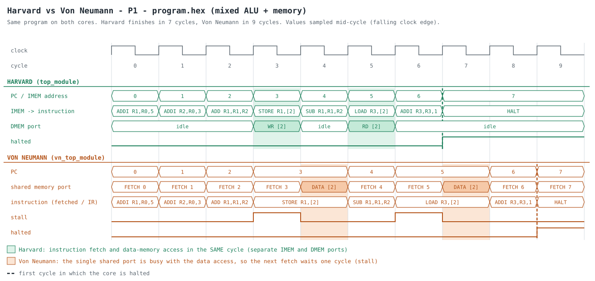
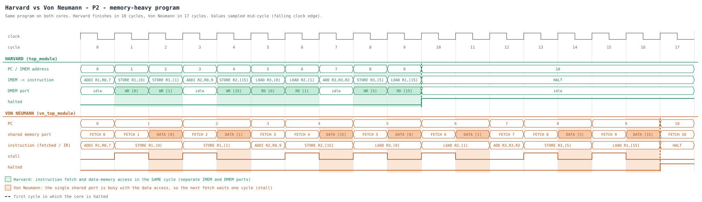
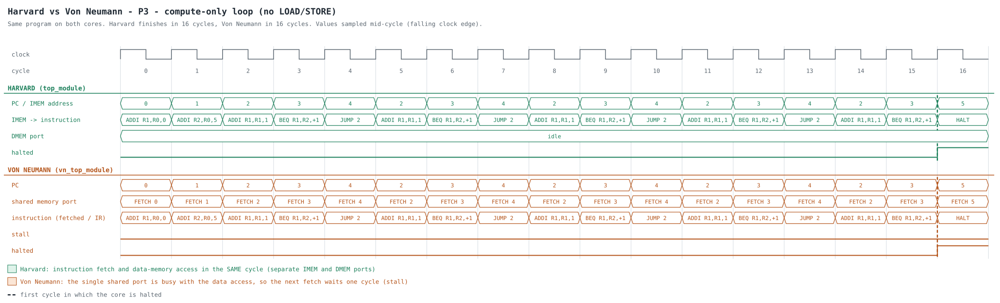

# Harvard vs Von Neumann (Shared-Memory) Comparison

This document describes the Von Neumann baseline added for comparison with the Vector Cores Harvard processor, and reports the measured results.

## 1. What Was Added

| File | Purpose |
|---|---|
| `rtl/baseline/unified_memory.v` | One 32 × 16-bit memory with a **single shared port** for instructions and data |
| `rtl/baseline/vn_top_module.v` | Von Neumann processor: same ISA and same PC, control unit, register file and ALU as the Harvard design, but using the unified memory |
| `testbench/harvard_vs_vn_tb.v` | Runs the same programs on both processors, checks they agree, and measures cycles, CPI and speed-up |

The existing Harvard RTL (`rtl/*.v`) is unchanged. The baseline reuses `program_counter`, `control_unit`, `register_file`, `alu` and `address_decoder` as they are, so **the only difference between the two designs is how memory is organized**.

## 2. Memory Organization

| | Harvard (`top_module`) | Von Neumann (`vn_top_module`) |
|---|---|---|
| Instruction storage | `instruction_memory`: 16 × 16-bit | `unified_memory` words `0x00`–`0x0F` |
| Data storage | `data_memory`: 16 × 8-bit | `unified_memory` words `0x10`–`0x1F` (bits `[7:0]`) |
| Memory ports | 2 independent (fetch port + data port) | 1 shared port |
| Address buses | 4-bit PC bus + 4-bit data bus | One 5-bit bus: `{0, PC}` for fetch, `{1, addr}` for data |
| Accesses per cycle | Fetch **and** data access | Fetch **or** data access |
| Program protection | Instruction memory is read-only by construction | Writes to the instruction region are blocked (`addr[4] = 0`) |
| Address decoding | `address_decoder` inside `data_memory` | `addr[4]` selects the region; `address_decoder` selects the word in the data region |

### Unified memory map

```text
 5-bit address
 0x00 ┌──────────────────────────┐
      │ Instruction region       │  loaded from program.hex, write-protected
 0x0F ├──────────────────────────┤
 0x10 │ Data region              │  data in bits [7:0], cleared on reset
 0x1F └──────────────────────────┘
```

## 3. Von Neumann Microarchitecture

Because there is only one memory port, a LOAD or STORE needs that port twice: once to fetch the instruction and once to read or write data. These two accesses cannot happen in the same cycle, so the design uses a two-state FSM.

```text
                 non-memory instruction (ADD/SUB/ADDI/BEQ/JUMP)
                 ┌───────────────┐   completes in 1 cycle
                 ▼               │
            ┌──────────┐ ────────┘
  reset ──► │ S_FETCH  │
            │ port={0,PC}       LOAD/STORE fetched:
            └──────────┘ ──────────────────────────┐ latch IR, hold PC,
                 ▲                                 │ block reg write (stall)
                 │                                 ▼
                 │                           ┌──────────┐
                 └────────────────────────── │  S_DATA  │
                    LOAD writes rd /         │ port={1,addr}
                    STORE writes memory,     └──────────┘
                    PC ← PC+1
```

| Instruction class | Harvard cycles | Von Neumann cycles |
|---|---:|---:|
| ADD, SUB, ADDI, BEQ, JUMP | 1 | 1 |
| LOAD, STORE | 1 | 2 (fetch + data) |

So for a program that executes **N** instructions, **M** of which are LOAD/STORE:

- Harvard cycles = **N**, CPI = **1**
- Von Neumann cycles = **N + M**, CPI = **1 + M/N**
- Harvard speed-up = **(N + M) / N = 1 + M/N**

## 4. Measured Results

Simulated with Icarus Verilog using `testbench/harvard_vs_vn_tb.v`. Cycles are counted from reset release until `halted` is asserted (the HALT instruction is not counted).

| Program | Description | N | M | Harvard cycles | VN cycles | Harvard CPI | VN CPI | Harvard speed-up |
|---|---|---:|---:|---:|---:|---:|---:|---:|
| P1 | `program.hex` (mixed ALU + memory) | 7 | 2 | 7 | 9 | 1.000 | 1.286 | **1.286×** |
| P2 | Memory-heavy (4 STORE, 3 LOAD) | 10 | 7 | 10 | 17 | 1.000 | 1.700 | **1.700×** |
| P3 | Compute-only loop (ADDI/BEQ/JUMP) | 16 | 0 | 16 | 16 | 1.000 | 1.000 | **1.000×** |

The testbench passed 151 checks with 0 failures. For each program it checks that:

- Both processors end with the same registers, data memory and PC, which also match the expected values.
- The measured cycle counts match the model: Harvard = N, Von Neumann = N + M.
- The number of Harvard cycles with a fetch and a data access in the same cycle equals M, which equals the number of Von Neumann stall cycles.
- STOREs never change the Von Neumann instruction region.

## 5. Analysis

1. **Simultaneous access.** In every Harvard cycle that runs a LOAD or STORE, the instruction memory is fetching while the data memory is being accessed. The testbench counts these cycles (`same-cycle fetch+data`): 2 in P1 and 7 in P2. In the Von Neumann design each of those cycles becomes a structural-hazard stall.
2. **Speed-up depends on the program.** The Harvard advantage grows linearly with the fraction of memory instructions (M/N). It is 0% for a compute-only loop and 70% for the memory-heavy program. If every instruction were a LOAD/STORE, the speed-up would reach its upper limit of 2×.
3. **Cost of the Von Neumann design.** It saves one memory and one address bus, but it needs extra control: a state flip-flop, a 16-bit instruction register, an address multiplexer for the shared port, and stall gating on the PC and register-file write.
4. **Program protection.** In the Harvard design a STORE cannot reach instruction memory at all. In the shared-memory design, protection has to be added on purpose (here, writes to the instruction region are blocked). Without it, a wrong address could overwrite the program.
5. **Clock period.** The shared memory also slows each cycle. In the Von Neumann design, instruction fetch passes through the shared-port address multiplexer and the 32-word unified-memory read multiplexer, so its critical path is longer. Place-and-route on iCE40 HX8K (median of 5 seeds, `synthesis/run_ice40.sh`) gives:

   | | Harvard | Von Neumann |
   |---|---:|---:|
   | Logic LUTs | 321 | 571 |
   | Flip-flops | 156 | 301 |
   | Fmax | 63.86 MHz | 37.69 MHz |
   | Clock period | 15.66 ns | 26.53 ns |

   Combining cycles and clock period, the Harvard speed-up in execution time is **2.18×** for P1, **2.88×** for P2, and **1.69×** for P3. The compute-only loop is faster too, because the clock is faster. See [`synthesis/results.md`](../synthesis/results.md) for the method and critical paths.

## 6. Annotated Waveforms

These figures are drawn from the comparison testbench's VCD. Green columns mark cycles where the Harvard processor fetches and accesses data memory in the same cycle. Orange columns mark cycles where the Von Neumann shared port is busy with data, so the next fetch stalls.

**P1 - `program.hex`:** STORE (PC 3) and LOAD (PC 5) each cost the Von Neumann core one extra cycle, giving 9 cycles against 7.



**P2 - memory-heavy:** 7 LOAD/STORE instructions give 7 stall cycles, so 17 cycles against 10.



**P3 - compute-only loop:** with no data accesses there are no stalls, and both take 16 cycles.



Regenerate with `python3 simulation/render_waveforms.py simulation/waveforms/harvard_vs_vn_wave.vcd docs/waveforms`. PNG copies are provided for the report.

## 7. How to Run

Run from the repository root, because both memories load `program.hex` using a relative path:

```bash
iverilog -s harvard_vs_vn_tb -o cmp_test rtl/*.v rtl/baseline/*.v testbench/harvard_vs_vn_tb.v && vvp cmp_test && rm -f cmp_test
```

The waveform is written to `simulation/waveforms/harvard_vs_vn_wave.vcd`:

```bash
gtkwave simulation/waveforms/harvard_vs_vn_wave.vcd
```

Useful signals to compare side by side:

- **Harvard:** `harvard.pc_current`, `harvard.instr_word`, `harvard.mem_read`, `harvard.mem_write`, `harvard.dmem_addr`
- **Von Neumann:** `vn.state`, `vn.mem_addr`, `vn.stall`, `vn.retire`, `vn.instr_word`, `vn.pc_current`

In the waveform, the Harvard core shows `pc_current` and `dmem_addr` both active in the same cycle, while the Von Neumann `mem_addr` switches from `{0,PC}` to `{1,addr}` across two cycles for every LOAD/STORE.
