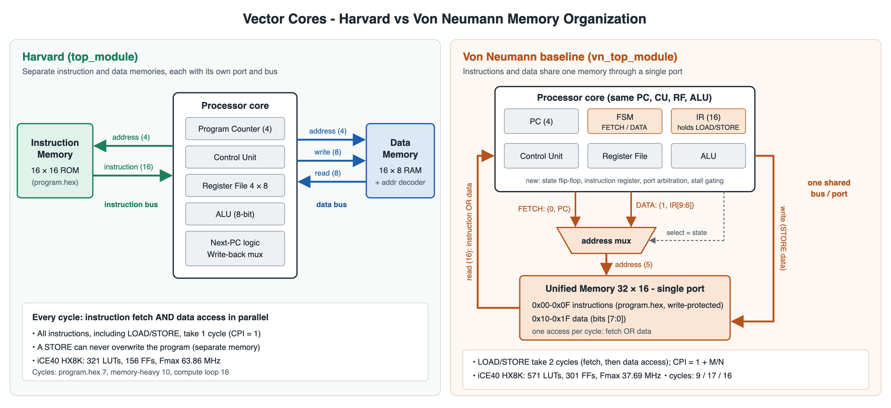
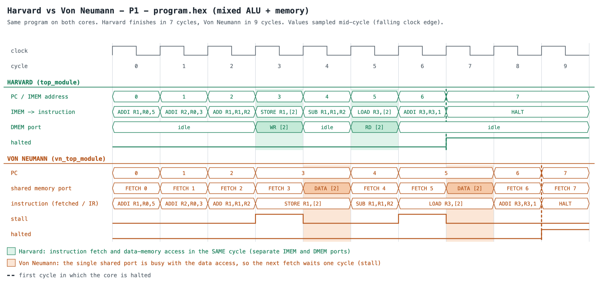
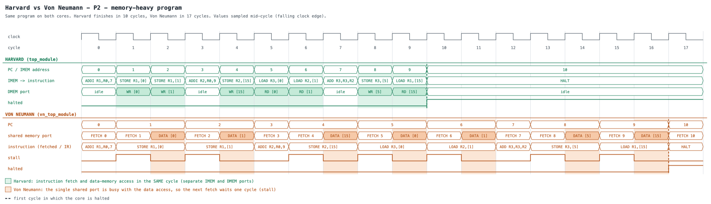

# Vector Cores: Final Technical Report

## Instruction and Data Memory Hierarchy Using Harvard Architecture, with a Von Neumann Comparison and a Shared Lower-Level Memory

**Team:** Pratiti Paul, Anuradha Raghuwanshi, Ganga Raghuwanshi, Alisha Gupta

**Course:** MCA Computer Architecture (Project 9: Instruction and Data Memory Hierarchy)

**Repository:** https://github.com/Pratiti-paul/Vector_Cores

---

## Abstract

Vector Cores is a 16-bit, single-cycle processor written in synthesizable Verilog (IEEE 1364-2001). It uses a Harvard memory organization, with a separate instruction memory and data memory, each with its own address and data path. The processor executes 11 instructions: LOAD, STORE, ADD, SUB, ADDI, BEQ, JUMP, AND, OR, XOR and HALT.

To evaluate the Harvard organization, a Von Neumann baseline was built. It uses the same processor core but one shared, single-port memory. A third version adds the optional shared lower-level memory: L1 instruction and data caches in front of one shared, slower L2 memory.

- **Verification:** thirteen self-checking Verilog testbenches pass **937 checks with 0 failures**, and the Python assembler passes 203 tests.
- **Cycle count:** the Harvard processor runs every instruction in one cycle (CPI = 1). The baseline needs a second cycle for each LOAD and STORE, so its CPI is 1 + M/N, where M/N is the fraction of memory instructions. This gives a cycle-count speed-up of 1.29× on the main program and 1.70× on a memory-heavy program.
- **Synthesis and timing:** on a Lattice iCE40 HX8K FPGA, the Harvard processor reaches a post-route **Fmax of 63.86 MHz** with 321 LUTs and 156 flip-flops. The Von Neumann baseline reaches 37.69 MHz with 571 LUTs and 301 flip-flops.
- **Execution time:** combining cycles and clock period, the Harvard design is **2.18×** faster on the main program and **2.88×** faster on the memory-heavy program.
- **Memory hierarchy:** with a 2-wait-state shared L2, the L1 caches reach I-cache hit rates of up to 76% and make loops up to **2.24×** faster than the same memory without caches. The hierarchy runs at 42.33 MHz.

---

## 1. Introduction and Objectives

A processor repeatedly fetches an instruction, decodes it, performs a computation or memory access, and selects the next instruction address. How instruction and data storage is organized determines whether the fetch and the data access can happen at the same time.

- In a **Harvard** organization, instructions and data are in separate memories with separate buses, so both can be accessed in the same cycle.
- In a **Von Neumann** organization, one memory and one bus hold both. An instruction that reads or writes data must therefore compete with the next instruction fetch for the memory port.

The project objectives were:

1. Implement a Harvard memory organization with independent instruction and data paths.
2. Build the supporting modules: Program Counter, Instruction Memory, Data Memory, Address Decoder and read/write control.
3. Connect them to a working processor and run programs that contain both instruction fetches and data accesses.
4. Analyze opportunities for simultaneous access, and compare the design against a shared-memory (Von Neumann) organization.
5. Add the optional shared lower-level memory behind separate L1 instruction and data caches.
6. Verify the design with directed testbenches and waveforms, and report performance, resource use and maximum frequency.

## 2. System Architecture



*Figure 1. Memory organization of the Harvard processor (left) and the Von Neumann baseline (right).*

### 2.1 Architecture Specifications

| Parameter | Harvard processor | Von Neumann baseline |
|---|---|---|
| Execution model | Single-cycle | 1 cycle (ALU/branch), 2 cycles (LOAD/STORE) |
| Instruction / data width | 16 bits / 8 bits | 16 bits / 8 bits |
| Instruction storage | Instruction Memory, 16 × 16 ROM | Unified Memory words 0x00-0x0F |
| Data storage | Data Memory, 16 × 8 RAM | Unified Memory words 0x10-0x1F |
| Memory ports | 2 (instruction + data) | 1 (shared) |
| Program Counter | 4 bits | 4 bits |
| Register File | 4 × 8 bits, R0 = 0 | 4 × 8 bits, R0 = 0 |
| ALU | 8-bit ADD, SUB, AND, OR, XOR; 3-bit control | Same |
| Clock / reset | Rising edge / active-high synchronous | Same |

### 2.2 Modules (RTL Hierarchy)

| Module | File | Function |
|---|---|---|
| `top_module` | `rtl/top_module.v` | Harvard processor top level: field decode, operand steering, write-back and next-PC logic |
| `program_counter` | `rtl/program_counter.v` | 4-bit PC register with synchronous reset and enable |
| `instruction_memory` | `rtl/instruction_memory.v` | 16 × 16 ROM, combinational read, loaded from `program.hex` |
| `control_unit` | `rtl/control_unit.v` | Opcode decoder; generates read/write control, ALU control and PC control |
| `register_file` | `rtl/register_file.v` | 4 × 8 registers, two read ports, one synchronous write port |
| `alu` | `rtl/alu.v` | 8-bit ALU with zero flag |
| `data_memory` | `rtl/data_memory.v` | 16 × 8 RAM, synchronous write, combinational read, synchronous clear |
| `address_decoder` | `rtl/address_decoder.v` | 4-to-16 one-hot word-select decoder used by Data Memory |
| `vn_top_module` | `rtl/baseline/vn_top_module.v` | Von Neumann baseline top level with FETCH/DATA state machine |
| `unified_memory` | `rtl/baseline/unified_memory.v` | 32 × 16 single-port memory for instructions and data |
| `mh_top_module` | `rtl/hierarchy/mh_top_module.v` | Memory-hierarchy processor: same core, L1 caches, stall logic |
| `icache` | `rtl/hierarchy/icache.v` | L1 instruction cache, 8 lines, direct-mapped |
| `dcache` | `rtl/hierarchy/dcache.v` | L1 data cache, 4 lines, direct-mapped, write-through |
| `mem_arbiter` | `rtl/hierarchy/mem_arbiter.v` | Shares the single L2 port between the two caches |
| `shared_memory` | `rtl/hierarchy/shared_memory.v` | L2: 32 × 16 single-port memory with 2 wait states |

### 2.3 Memory Control (Read/Write)

The Control Unit drives `mem_read` and `mem_write` from the opcode:

- **LOAD** asserts `mem_read` and `mem_to_reg`, so the data word is written into the destination register.
- **STORE** asserts `mem_write`. The 4-to-16 address decoder converts the 4-bit address into a one-hot word-select signal, so exactly one memory word is written on the rising clock edge.
- **Read output gating:** when `mem_read` is low, the data-memory output is forced to zero.
- **Write protection:** the instruction memory is read-only by construction, so a STORE cannot change the program.

## 3. Microarchitecture

### 3.1 Instruction Set and Encoding

| Instruction | Opcode | Fields [11:0] | Operation |
|---|---|---|---|
| LOAD | 0001 | rd[11:10], addr[9:6] | R[rd] = DMEM[addr] |
| STORE | 0010 | rs[11:10], addr[9:6] | DMEM[addr] = R[rs] |
| ADD | 0011 | rd, rs[9:8], rt[7:6] | R[rd] = R[rs] + R[rt] |
| SUB | 0100 | rd, rs, rt | R[rd] = R[rs] - R[rt] |
| ADDI | 0101 | rd, rs, imm[7:0] | R[rd] = R[rs] + imm |
| BEQ | 0110 | rs[11:10], rt[9:8], off[7:0] | if equal: PC = PC + 1 + off |
| JUMP | 0111 | target[3:0] | PC = target |
| AND | 1000 | rd, rs, rt | R[rd] = R[rs] & R[rt] |
| OR | 1001 | rd, rs, rt | R[rd] = R[rs] OR R[rt] |
| XOR | 1010 | rd, rs, rt | R[rd] = R[rs] ^ R[rt] |
| HALT | 1111 | - | stop PC, assert halted |

### 3.2 Control Signals

| Opcode | pc_en | reg_wr | mem_rd | mem_wr | alu_ctl | alu_src | mem_to_reg | branch | jump | halted |
|---|---|---|---|---|---|---|---|---|---|---|
| LOAD | 1 | 1 | 1 | 0 | 000 | 0 | 1 | 0 | 0 | 0 |
| STORE | 1 | 0 | 0 | 1 | 000 | 0 | 0 | 0 | 0 | 0 |
| ADD | 1 | 1 | 0 | 0 | 000 | 0 | 0 | 0 | 0 | 0 |
| SUB | 1 | 1 | 0 | 0 | 001 | 0 | 0 | 0 | 0 | 0 |
| ADDI | 1 | 1 | 0 | 0 | 000 | 1 | 0 | 0 | 0 | 0 |
| BEQ | 1 | 0 | 0 | 0 | 001 | 0 | 0 | 1 | 0 | 0 |
| JUMP | 1 | 0 | 0 | 0 | 000 | 0 | 0 | 0 | 1 | 0 |
| AND | 1 | 1 | 0 | 0 | 010 | 0 | 0 | 0 | 0 | 0 |
| OR | 1 | 1 | 0 | 0 | 011 | 0 | 0 | 0 | 0 | 0 |
| XOR | 1 | 1 | 0 | 0 | 100 | 0 | 0 | 0 | 0 | 0 |
| HALT | 0 | 0 | 0 | 0 | 000 | 0 | 0 | 0 | 0 | 1 |
| invalid | 0 | 0 | 0 | 0 | 000 | 0 | 0 | 0 | 0 | 0 |

### 3.3 Harvard Datapath Timing

Every instruction completes in one clock cycle. During that cycle:

1. The PC addresses the instruction memory, and the instruction is read combinationally.
2. The Control Unit decodes the instruction, the register file supplies the operands, and the ALU computes its result.
3. For LOAD/STORE, the data memory is accessed **at the same time**, through its own address bus.
4. At the rising clock edge, the register file, the data memory (for STORE) and the PC are updated.

Next-PC selection works as follows:

- JUMP loads `target`.
- A taken BEQ loads `PC + 1 + offset`, wrapped to 4 bits.
- Any other instruction loads `PC + 1`.
- HALT stops the PC by clearing `pc_enable`.

### 3.4 Von Neumann Baseline: State Transitions

The baseline's single memory port can serve only one access per cycle. It is controlled by a two-state machine:

| State | Port address | Action | Next state |
|---|---|---|---|
| FETCH | {0, PC} | Non-memory instruction: execute and update the PC in this cycle. | FETCH |
| FETCH | {0, PC} | LOAD/STORE: latch the instruction into IR; hold the PC; block register write-back (stall). | DATA |
| DATA | {1, IR[9:6]} | LOAD: write the memory word into rd. STORE: write R[rs]. PC = PC + 1. | FETCH |

The data address is taken directly from IR. This means the port address never depends on the port's own read data, which avoids a combinational loop (Section 7.4).

## 4. Implementation Workflow

1. **RTL design:** each module was written and unit-tested separately, then integrated in `top_module`.
2. **Instruction and data paths:** the PC and instruction memory form the instruction path. The address decoder, data memory and read/write control form the data path.
3. **Programs:** test programs were written in assembly, assembled with the team's Python two-pass assembler (`assembler/`), and loaded through `program.hex`.
4. **Baseline:** the Von Neumann baseline reuses the PC, control unit, register file, ALU and address decoder unchanged. Only the memory organization differs.
5. **Verification, synthesis and timing:** simulation used Icarus Verilog, synthesis used Yosys, and place-and-route and timing used nextpnr.

## 5. Verification

### 5.1 Testbenches

All testbenches are self-checking: each compares results against expected values and reports pass/fail counts.

| Testbench | Level | Checks passed | Failed |
|---|---|---|---|
| program_counter_tb | Unit | 35 | 0 |
| instruction_memory_tb | Unit | 16 | 0 |
| register_file_tb | Unit | 6 | 0 |
| alu_tb | Unit | 13 | 0 |
| address_decoder_tb | Unit | 40 | 0 |
| data_memory_tb | Unit | 79 | 0 |
| control_unit_tb | Unit | 130 | 0 |
| processor_tb | System | 7 | 0 |
| control_flow_tb | System | 13 | 0 |
| boundary_reset_tb | System | 15 | 0 |
| logical_ops_tb | System | 56 | 0 |
| harvard_vs_vn_tb | Comparison | 151 | 0 |
| memory_hierarchy_tb | Comparison | 376 | 0 |
| **Total** | | **937** | **0** |

The Python assembler test suite (pytest) passes 203 tests. This is a separate count and is not included in the total above.

### 5.2 Coverage

- **Unit level:**
  - Program Counter: reset, hold, all 16 addresses, wraparound, and reset priority.
  - Instruction memory: all locations.
  - Data memory: all 16 locations, write/read inhibition, synchronous-write and combinational-read timing.
  - Address decoder: one-hot output for every address.
  - Control unit: all 16 opcodes.
- **System level:**
  - The sample program.
  - BEQ taken and not taken; forward and backward branches.
  - JUMP; HALT with PC freeze; negative offsets and PC wraparound; reset.
  - AND/OR/XOR execution, including assembler-generated machine code.
- **Comparison:** the same three programs run on the Harvard and Von Neumann processors, which must reach identical register, data-memory and PC states. Measured cycle counts are checked against the analytical model (Harvard = N, Von Neumann = N + M). The testbench also checks that STORE never modifies the Von Neumann instruction region.

### 5.3 Sample Program

| Addr | Hex | Instruction | Result |
|---|---|---|---|
| 0 | 5405 | ADDI R1, R0, 5 | R1 = 5 |
| 1 | 5803 | ADDI R2, R0, 3 | R2 = 3 |
| 2 | 3580 | ADD R1, R1, R2 | R1 = 8 |
| 3 | 2480 | STORE R1, [2] | DMEM[2] = 8 |
| 4 | 4580 | SUB R1, R1, R2 | R1 = 5 |
| 5 | 1C80 | LOAD R3, [2] | R3 = 8 |
| 6 | 5F01 | ADDI R3, R3, 1 | R3 = 9 |
| 7 | F000 | HALT | PC = 7, halted = 1 |

## 6. Simulation Waveforms and Simultaneous Access

The figures below are drawn from the comparison testbench's VCD output (`simulation/render_waveforms.py`).

- **Green columns** are cycles in which the Harvard processor fetches an instruction **and** accesses data memory in the same cycle.
- **Orange columns** are cycles in which the Von Neumann port is busy with a data access, so the next fetch stalls.



*Figure 2. program.hex. The STORE at PC 3 and the LOAD at PC 5 each add one cycle to the Von Neumann processor: 9 cycles against 7.*



*Figure 3. Memory-heavy program. Its 7 LOAD/STORE instructions give 7 stall cycles: 17 cycles against 10.*

**Simultaneous access analysis.** In the Harvard design, the number of cycles that overlap a fetch with a data access equals the number of memory instructions M: 2 in P1 and 7 in P2. In the Von Neumann design, each of these overlaps becomes a structural-hazard stall. A compute-only loop (P3) has no data accesses, so no overlap is possible and both designs take 16 cycles.

## 7. Performance and Synthesis Results

### 7.1 Cycle-Level Performance

| Program | N | M | Harvard cycles | VN cycles | Harvard CPI | VN CPI | Cycle speed-up |
|---|---|---|---|---|---|---|---|
| P1 program.hex | 7 | 2 | 7 | 9 | 1.000 | 1.286 | 1.29× |
| P2 memory-heavy | 10 | 7 | 10 | 17 | 1.000 | 1.700 | 1.70× |
| P3 compute loop | 16 | 0 | 16 | 16 | 1.000 | 1.000 | 1.00× |

For N instructions, M of which are LOAD/STORE, Harvard CPI = 1 and Von Neumann CPI = 1 + M/N. The cycle speed-up is therefore 1 + M/N. It approaches 2× as the fraction of memory instructions approaches 100%.

### 7.2 Generic Synthesis (Yosys)

The generic flow (`hierarchy; proc; opt; memory; opt; check; stat`) reports **125 generic cells** and **0 structural problems** for the Harvard processor. Yosys replaces the data-memory array with registers because the RTL clears all 16 locations on reset.

### 7.3 FPGA Resource Utilization

| Resource | Harvard | Von Neumann |
|---|---|---|
| Xilinx 7-Series LUTs (Yosys `synth_xilinx`) | 202 | 287 |
| Xilinx 7-Series flip-flops (FDRE) | 156 | 301 |
| Xilinx CARRY4 | 6 | 6 |
| iCE40 HX8K LUT4 | 321 | 571 |
| iCE40 HX8K flip-flops | 156 | 301 |
| Block RAM | 0 | 0 |

- **Harvard flip-flops (156):** 128 data-memory bits + 24 register bits + 4 PC bits.
- **Von Neumann flip-flops (301):** 256 bits for the 16-bit-wide data region + 16-bit IR + 24 register bits + 4 PC bits + 1 state bit.

### 7.4 Maximum Operating Frequency

Place-and-route and static timing were performed with nextpnr-ice40 on an iCE40 HX8K (CT256), using 5 placement seeds per design (median reported). Every output is registered by a wrapper (`synthesis/fmax_wrappers.v`), so all timed paths start and end at flip-flops.

| Metric | Harvard | Von Neumann |
|---|---|---|
| Fmax, median of 5 seeds | **63.86 MHz** | **37.69 MHz** |
| Fmax range | 58.98 - 65.65 MHz | 37.20 - 40.55 MHz |
| Minimum clock period | 15.66 ns | 26.53 ns |

**Critical paths:**

- **Harvard:** PC → instruction ROM → register-file read → ALU carry chain → write-back.
- **Von Neumann:** the same path, plus the shared-port address multiplexer and the 32-word unified-memory read multiplexer in front of decode.

Synthesis of the first baseline version also found a structural combinational loop: memory address → read data → instruction → memory address. It never activated in simulation, but it was removed by taking the data address directly from IR.

### 7.5 Execution Time

| Program | Harvard | Von Neumann | Harvard speed-up |
|---|---|---|---|
| P1 program.hex | 109.6 ns | 238.8 ns | **2.18×** |
| P2 memory-heavy | 156.6 ns | 451.0 ns | **2.88×** |
| P3 compute loop | 250.5 ns | 424.5 ns | **1.69×** |

At 63.86 MHz and CPI = 1, the Harvard processor's peak throughput is about **63.9 million instructions per second**.

## 8. Architecture Comparison

| Aspect | Harvard | Von Neumann (shared memory) |
|---|---|---|
| Memory ports per cycle | 2: fetch and data | 1: fetch or data |
| LOAD/STORE latency | 1 cycle | 2 cycles |
| CPI | 1 | 1 + M/N |
| Clock frequency (iCE40) | 63.86 MHz | 37.69 MHz |
| LUTs / FFs (iCE40) | 321 / 156 | 571 / 301 |
| Extra control | None | FSM, instruction register, port multiplexer, stall gating |
| Program protection | Inherent (separate ROM) | Needs explicit write-protection of the instruction region |
| Flexibility | Fixed split between code and data | Code and data can share space |

The Harvard organization is faster for two separate reasons:

1. **No structural hazard.** The fetch and the data access never compete for a port, which removes M cycles per program.
2. **Shorter critical path.** In the Von Neumann design, instruction fetch must pass through the shared memory's port multiplexer and its larger read multiplexer, which lowers the clock frequency. Because of this, even a program with no memory instructions runs 1.69× faster on the Harvard design.

The Von Neumann design's main advantage is flexibility: one memory can be divided between code and data in any proportion. In this small design, that flexibility does not save hardware. Storing 8-bit data in 16-bit words, plus the extra control logic, makes the baseline larger.

## 9. Shared Lower-Level Memory (Memory Hierarchy)

The optional shared lower-level memory was implemented as a two-level hierarchy (Figure 4). This "modified Harvard" organization is the one used by most real processors.

```
   Processor core (same PC, control unit, register file, ALU)
        | instruction path              | data path
   [ L1 I-cache 8 x 16 ]           [ L1 D-cache 4 x 8, write-through ]
              \                           /
               +------ mem_arbiter -------+     one access at a time
                            |
          [ shared L2 memory 32 x 16, single port, 2 wait states ]
```

*Figure 4. L1 instruction and data caches over a shared lower-level memory.*

### 9.1 Operation

The processor stalls whenever the memory system is busy, so the cost of each access depends on where it is served:

- **Hits:** on a hit in both caches, the processor completes each instruction in one cycle, exactly like the Harvard design.
- **I-cache miss:** costs 3 extra cycles. The word is requested from L2, written into the cache line, and the instruction executes in the next cycle. Executing only from the line avoids a combinational loop through the shared port.
- **LOAD miss:** costs 2 extra cycles; the data is forwarded to the register file.
- **STORE:** costs 2 extra cycles, because it is written through to L2. The line is also allocated, so a later LOAD of the same address hits.

This gives the cycle model **N + 3 × I-misses + 2 × (LOAD misses + STOREs)**, which the testbench verifies against the measured miss counts.

Setting `CACHE_ENABLE = 0` turns both caches off. In that "L2 only" configuration every fetch and every LOAD goes to the slow shared memory.

### 9.2 Results

| Program | Harvard | Von Neumann | L1 + shared L2 | L2 only | I-cache hit rate | LOAD hits |
|---|---|---|---|---|---|---|
| P1 program.hex | 7 | 9 | 33 | 35 | 0% | 1 / 1 |
| P2 memory-heavy | 10 | 17 | 51 | 57 | 0% | 3 / 3 |
| P3 compute loop | 16 | 16 | 34 | 67 | 64.7% | - |
| P4 memory loop | 37 | 49 | 78 | 175 | 76.3% | 5 / 6 |

All four processors reach identical final registers, data memory and PC (`memory_hierarchy_tb`, 376 checks).

- **Loops:** the caches speed up loops by **1.97×** (P3) and **2.24×** (P4) over the uncached shared memory.
- **Straight-line code:** gains little, because every fetch is a first-time (compulsory) miss.
- **Steady state:** after the first iteration, each P4 loop iteration takes 8 cycles (CPI 1.33). This equals the Von Neumann processor with an ideal single-cycle memory, against 28 cycles (CPI 4.67) without caches.
- **Memory latency:** with 0, 2 and 5 wait states, the cache speed-up on P4 grows from 1.63× to 2.24× to 2.58×. The slower the shared memory, the more the L1 caches are worth.

### 9.3 Hardware Cost

| Metric (iCE40 HX8K) | Harvard | Von Neumann | L1 + shared L2 |
|---|---|---|---|
| LUT4 | 321 | 571 | 689 |
| Flip-flops | 156 | 301 | 476 |
| Fmax (median of 5 seeds) | 63.86 MHz | 37.69 MHz | 42.33 MHz |

On Xilinx 7-Series, the hierarchy maps to 325 LUTs and 300 flip-flops, with the cache arrays in 5 RAM32M distributed-RAM cells.

The critical path is a LOAD miss: I-cache read → decode → D-cache tag compare → L2 read → forwarded data. Refilling the D-cache first and executing the LOAD in the next cycle would raise Fmax at the cost of one more cycle per LOAD miss.

## 10. Limitations and Future Work

- The address space is small (16 instructions, 16 data words), and the data width is 8 bits.
- Both memories are built from flip-flops, not block RAM, because they are cleared on reset and read combinationally. Synchronous-read memories would map to FPGA block RAM.
- Fmax was measured with the open-source iCE40 flow. Xilinx timing (Vivado), board-level testing and power measurement have not been performed.
- The caches are small and direct-mapped, with one word per line. Larger lines (spatial locality), set-associativity and a write buffer for stores are natural extensions.

## 11. Conclusion

Vector Cores implements and verifies a Harvard instruction and data memory hierarchy: separate instruction and data paths, address decoding and read/write control, integrated into an 11-instruction single-cycle processor. Thirteen self-checking testbenches pass 937 checks.

A Von Neumann baseline built from the same core quantifies the benefit of separate instruction and data memories:

- **Cycles:** CPI rises from 1 to 1 + M/N without them.
- **Clock frequency:** Fmax falls from 63.86 MHz to 37.69 MHz.
- **Execution time:** the Harvard design is 2.18× faster on the main program and up to 2.88× faster on memory-heavy code.

The shared lower-level memory combines both ideas. L1 instruction and data caches keep the Harvard split on hits, and one shared L2 memory holds instructions and data. With a slow shared memory, the caches make loops up to 2.24× faster, with steady-state loop performance equal to a Von Neumann processor that has an ideal single-cycle memory.

## Appendix A: Reproducing the Results

All commands are run from the repository root.

```
# Full Verilog regression (13 testbenches): see README Section 8.5
iverilog -g2012 -s harvard_vs_vn_tb -o cmp_test rtl/*.v rtl/baseline/*.v testbench/harvard_vs_vn_tb.v
vvp cmp_test
iverilog -g2012 -s memory_hierarchy_tb -o mh_test rtl/*.v rtl/baseline/*.v rtl/hierarchy/*.v testbench/memory_hierarchy_tb.v
vvp mh_test

# Waveform figures
python3 simulation/render_waveforms.py simulation/waveforms/harvard_vs_vn_wave.vcd docs/waveforms

# Synthesis reports (generic + Xilinx 7-Series) and iCE40 Fmax
bash synthesis/run_yosys_reports.sh
bash synthesis/run_ice40.sh

# Python assembler tests
python3 -m pytest tests/

# Rebuild this report as PDF (needs reportlab)
python3 docs/report/build_report.py
```

## Appendix B: Tools

Icarus Verilog (simulation), Yosys 0.71 (synthesis), nextpnr-ice40 0.11.1 (place-and-route and timing), Python 3 (assembler, waveform rendering, report build), pytest (assembler tests).
