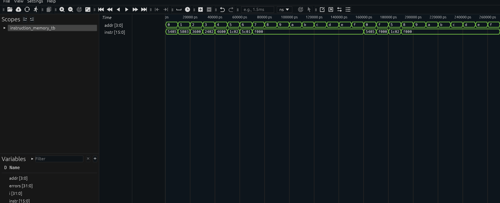

## Instruction Memory – Simulation Results

**Tool:** Icarus Verilog 13.0, waveform viewed in Surfer.
**Command:**
```
iverilog -o imem testbench/instruction_memory_tb.v rtl/instruction_memory.v
vvp imem
```

**Result:** all 16 locations passed.
```
PASS addr=0 instr=5405 opcode=0101 rd=1 rs=0 imm=5
PASS addr=1 instr=5803 opcode=0101 rd=2 rs=0 imm=3
PASS addr=2 instr=3600 opcode=0011 rd=1 rs=2 imm=0
PASS addr=3 instr=2402 opcode=0010 rd=1 rs=0 imm=2
PASS addr=4 instr=4600 opcode=0100 rd=1 rs=2 imm=0
PASS addr=5 instr=1c02 opcode=0001 rd=3 rs=0 imm=2
PASS addr=6 instr=5c01 opcode=0101 rd=3 rs=0 imm=1
PASS addr=7..15 instr=f000 (HALT)
ALL INSTRUCTION MEMORY TESTS PASSED
```

### Waveform


*Figure: `instr` changes immediately with `addr` (asynchronous read). Addresses 0-6 return the program, addresses 7-15 return HALT (F000), and the final addr 0 -> F -> 5 sequence confirms non-sequential access.*

### Observations
- Instruction memory is read-only and needs no clock; latency is purely combinational.
- Because it is separate from data memory, instruction fetch and data access can happen in the same cycle (Harvard advantage). A shared-memory design would need to serialise them.
- Synthesis results (resource utilisation and maximum frequency) are reported separately in the synthesis section.